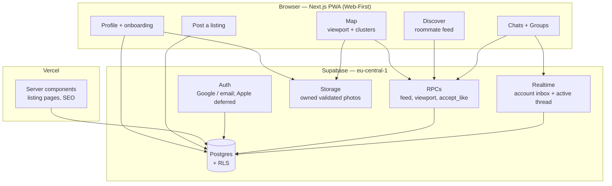

# Architecture

Companion to `DECISIONS.md`. Where this document and the register disagree, the register wins.

Scale target: **1,000 active listings, 3,000 registered renters, a few hundred concurrent users at peak**.

---

## 1. System map

**The rule that shapes everything below: RLS is an authorization boundary, not a query planner.** Reads that need filtering, ranking or pagination go through an RPC. RLS only answers "may this user touch this row at all".

---

## 2. Stack

| Layer | Choice | Why |
|---|---|---|
| Frontend | Next.js (App Router) on Vercel | Decided K1. Web-first platform to prioritize SEO and sharing. Mobile (React Native) is Phase 2. |
| Styling | Tailwind + existing components | Fast, accessible components with built-in styling. I3 decided: preserve existing components/tokens; add accessible primitives only for concrete need.
| Backend | Supabase — Postgres, Auth, Realtime, Storage | Already provisioned, eu-central-1. Isolated development/QA local-first under free-only budget; existing hosted backend changes separately authorized (J12/K3). |
| Errors / analytics | First-party minimal events + sanitized error IDs | J13: useful interactions/replies and declared outcomes; no mandatory external analytics. |

---

## 3. Query Strategy & Performance (decision-gated proposals)

J2-J7/J10 technical defaults are now decided; exact adapters/limits in docs/specs/TECHNICAL_DEFAULTS.md. J8 hosted capacity still needs evidence. Reconcile working code before any replacement; no mandatory PostGIS. Planning entry: docs/WORK_PLAN.md.

### 3.1 Map Viewport Rendering
*   **Decided MVP model (J2/J6):** bounded viewport query using approximate public coordinates; no required PostGIS migration. `map_listings(bounds, zoom)` is a proposed contract, not an existing guaranteed API.
*   **Why:** Instead of downloading 1,000 apartments with their photos and descriptions into the client memory at startup, the client asks the server only for pins visible on the screen. The payload is tiny (`id, approximate_lat, approximate_lng, price`; favorites separately user-scoped). Clicking a pin runs a targeted query to fetch the heavy details.

### 3.2 Discover Feed Pagination
*   **The Model:** Server-side Keyset Pagination via RPC.
*   **Why:** Passing an unbounded array of passed/liked profiles in the client URL string (`NOT IN (...)`) breaks at scale. The database must exclude past interactions internally using `NOT EXISTS` subqueries.

### 3.3 Hype Counters
*   **The Model:** Indexed aggregates over unique active personal saves, plus available-room counts/ranges (J4).
*   **Why:** Keep one authority and correct retry/unsave semantics; optimize only after measured query need with a reconciliation path.

### 3.4 Chat Previews
*   **The Model:** A `last_message_id` reference on the `conversations` table.
*   **Why:** Fetching every message from every conversation just to build the inbox preview list causes massive payload bloat.

### 3.5 Image Processing Pipeline
*   **The Model:** Client-side compression before upload.
*   **Why:** Saves bandwidth, reduces storage costs, and offloads processing to the user's device rather than paying for server-side image transformations.

### 3.6 Data Fetching & SEO
*   **The Model:** Next.js Server Components for SEO pages, Client Components for interaction.
*   **Why:** Public apartment pages use Server-Side Rendering (SSR) to inject OpenGraph tags so WhatsApp/Facebook links render rich previews. Highly interactive screens (like the Map or swiping) use standard Client Components to talk to Supabase instantly.

---

## 4. Security Model

Four invariants. Each exists because the obvious implementation is wrong.

**4.1 Hype identity is withheld server-side.**
The personal-saver list and identities are private in MVP, regardless of account type. Only unique aggregate count is public (G1/G2). Free inbound invitations identify sender for consent; this never identifies who privately saved a listing. Future Pro visibility needs a separate explicit privacy decision.

**4.2 `is_pro` and `is_verified` are revoked at the column level.**
RLS cannot express "any column except these two".

**4.3 Multi-write operations are RPCs, not client sequences.**
Accepting a like creates a conversation, adds two members and posts a message. This happens via one `SECURITY DEFINER` function (`accept_like`).

**4.4 Profile privacy uses separate private data and an explicit public projection.**
Contact details, birth date, budget, move-in date, and student email live in an owner-only `profile_private` row. Public profile reads go through an allowlisted projection that returns age (never birth date), profile fields, selected public badges, and no contact details. Direct reads of private fields are not granted to other authenticated users.

Apartment addresses and exact coordinates are also private. Public listing projections exclude exact address/coordinates, contact information and private owner data. The planned safe pin is persisted random displacement independent of public ID (TECHNICAL_DEFAULTS); the deterministic 500m source transform remains an identified migration/verification gap, not evidence the replacement is live. Private location reads require a valid accepted apartment-context grant (renter inquiry or accepted poster invitation), under D4 block/deletion rules.

---

## 5. Bidirectional layout standard (I7, I9)

The app ships Hebrew (RTL) and English (LTR) from v1. Direction is a property of the locale, not of a stylesheet override. There is no RTL stylesheet and no `[dir="rtl"]` override block — if one appears, a component underneath it used a physical value and should be fixed instead.

**The rule: no component, token, or design spec contains `left` or `right`.**

| Never | Always |
|---|---|
| `margin-left` / `margin-right` | `margin-inline-start` / `margin-inline-end` |
| `padding-left` / `padding-right` | `padding-inline-start` / `padding-inline-end` |
| `left: 0` / `right: 0` | `inset-inline-start: 0` / `inset-inline-end: 0` |
| `text-align: left` | `text-align: start` |
| `border-left` / `border-right` | `border-inline-start` / `border-inline-end` |
| `border-radius: 8px 0 0 8px` | `border-start-start-radius` etc., or the 4-value logical shorthand |
| Tailwind `ml-4`, `pl-2`, `left-0`, `text-left` | `ms-4`, `ps-2`, `start-0`, `text-start` |
| `flex-direction: row-reverse` to "fix" RTL | plain `row` — the writing direction already reverses it |

**Icons.** Direction-carrying icons (back, forward, next, previous, send, chevrons, progress arrows) mirror with the locale. Non-directional icons (search, heart, user, map pin, plus, camera) never mirror. Mirror with `transform: scaleX(-1)` scoped to `[dir="rtl"]`, or ship a mirrored asset — decide once, apply everywhere.

**Content that never flips.** Phone numbers, prices with currency, dates, latitude/longitude, and email addresses stay LTR inside RTL text. Wrap them in `<bdi>` or `dir="ltr"` or they render scrambled next to Hebrew.

**Numerals.** Western Arabic numerals (0-9) in both locales. No Eastern Arabic numerals.

**Enforcement.** `dir` is set once on `<html>` from the active locale. Verify every screen in both locales before it is called done — a screen that has only been seen in Hebrew is not finished.

---

## 6. Design tokens (I2, I14, I15)

Sourced from the design handoff (`design_handoff_shutaf_design_system/`). These are decided values, not placeholders — implement as CSS custom properties / Tailwind theme extensions, not inline hex codes.

**Color**

| Token | Hex | Use |
|---|---|---|
| Orange — Primary | `#E2883A` | primary actions, brand |
| Orange Soft | `#FBE7D2` | tinted backgrounds |
| Orange Dark | `#B5661F` | button shadow/pressed state |
| Teal — Secondary | `#1F94B3` | trust, links |
| Teal hover | `#16748C` | link hover |
| Gold — Favorites | `#F0B429` | favorite/star |
| Green — Success | `#4E9F63` | success, verified, match |
| Red — Error | `#DB5A4A` | error, destructive |
| Ink | `#262220` | primary text, dark-mode surfaces |
| Body text | `#4A4340` | secondary text |
| Muted text | `#837B76` | tertiary text/labels |
| Disabled text | `#B4ACA6` | disabled states |
| Neutral bg | `#F1ECE5` / `#F8F5F1` | cards, inputs, chips |
| Border | `#E8E2DC` | card/input borders |
| Page background | `#FBF9F6` | app background |
| Teal soft | `#DCF0F5` | tinted teal backgrounds |
| Dark mode surface | `#1C1917` / `#262220` | **not used in v1 — DECISIONS.md I11 says no dark mode.** Kept here for reference only. |
| Dark mode text | `#F5F0EA` | **not used in v1** — see I11. |

**Typography**: Rubik (400/500/600/700/800/900), via Google Fonts / `next/font/google`. Display 48px/800, H1 24px/700, Body 16px/400 (1.6 line-height), Caption 13px/500. Already wired in `web/src/app/layout.tsx`.

**Shape**: radius scale 12 / 16 / 20 / 24 / 28 / pill (999px).

**Shadows**: buttons use a "pressed" hard-shadow style — `box-shadow: 0 4px 0 <dark-variant>, 0 6px 14px rgba(38,34,32,0.15)`, collapsing to `0 0 0` on `:active` with a `translateY` press.

**Spacing**: card padding 16–40px depending on density; section gaps 32–96px on desktop; mobile screen padding 20–24px.

**Icons**: hand-built inline SVG, not an icon font/library. Each nav/tag icon carries its own brand color (never a single neutral gray). Direction-carrying icons mirror per §5; non-directional icons never do.

---

## 7. Client-side state shape (from the design handoff)

Minimum state the app needs per screen group — a starting point for whatever state/data-fetching layer gets picked (React Query, Zustand, plain Server Components + `fetch`, etc. — existing React/local/server state first; no mandatory new state library under I3):

- **Session/user**: residency (resident vs. non-resident property poster; no resident search mode), verification status, language preference.
- **Profile**: approved structured facts/preferences, with nonexclusive facts separated rather than forcing every category into one single-select value. C1 inventory retained, C2 normalized baseline adopted 17 October, wording refinements allowed.
- **Map/Discover**: viewport bounds → pin query, favorited listing IDs, Discover tab (Individuals or Groups, independent of account and group membership), swipe queue and decisions.
- **Group**: up to four members per group, multiple memberships allowed; safe public lifestyle summary, no member-derived public budget. Optional explicitly entered group-search budget private to members (E1/E6). Chat cards use per-viewer personal saves, no group wishlist entity (E7).
- **Chats**: pending likes queue, active thread list, per-thread message history, unread counts.
- **Composer**: draft listing fields, required-field validation state, publish status.
- **Monetization (later)**: potential Pro entitlements require approved commercial policy; no paywall in initial MVP. Save-counter identity remains private under G1/G2, not exposed by frontend blur.

17 October checkpoint: ordered dispatch [WORK_PLAN](docs/WORK_PLAN.md), bounded [EXECUTION_PACKETS](docs/EXECUTION_PACKETS.md). Nonresident posters browse safe people and send apartment-bound invitations; recipient acceptance precedes chat/address. Saver identities remain private. Technical/moderation defaults adopted; runtime evidence remains separate. DECISIONS.md wins.
